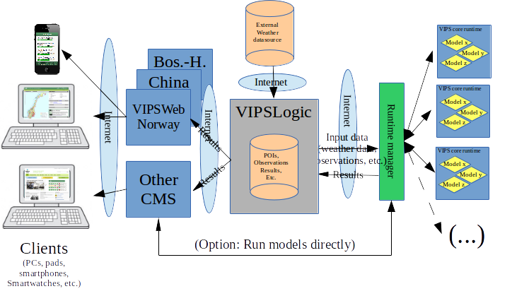

# VIPSLogic

Tor-Einar Skog, NIBIO

Last update: 2022-01-05

## Overview
VIPSLogic is the administration and business logic system of VIPS. Its main functionalities are:

* Batch running of models 
* Caching/storing results from batch runs
* Database of field pest observations
* Management of organizations, users, farmer's fields, crops, pests and weather data sources
* Messaging / subscription services
* Web services to support VIPS's own public web pages and 3rd party clients

No models are deployed in VIPSLogic. It depends on web services from VIPSCore/VIPSCoreManager to run the models. However, for each model available in the VIPSCore/VIPSCoreManager system VIPSLogic needs a preprocessor to compile the model specific input data.

VIPSLogic is the source of data for most clients, including VIPSWeb, the standard public web page for a VIPS system. 

VIPSLogic is a part of the [VIPS platform for automatic pest prediction](https://gitlab.nibio.no/VIPS/documentation)

## Technical description
### Requirements
* Operating system: Ubuntu Linux >= 18.0.4 
* Database: PostgreSQL >= 10  + PostGIS >= 2.4
* Java: OpenJDK >= 11
* Java EE application server: Wildfly >= 25

## License
VIPSLogic is licensed under the [GNU Affero GPL v3 license](https://www.gnu.org/licenses/agpl-3.0.en.html).

## Web services
The web services documentation is auto generated using Enunciate, you can read it from this path relative to your VIPSLogic deployment: `/public/RESTdocs/apidocs/`, for instance [here on NIBIO's deployment](https://logic.vips.nibio.no/public/RESTdocs/apidocs/)

## Develop and deploy VIPSLogic
Please read [the developer documentation](./docs/index.md)