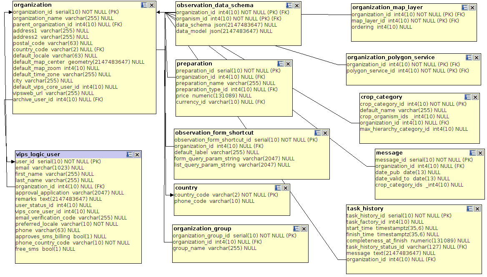
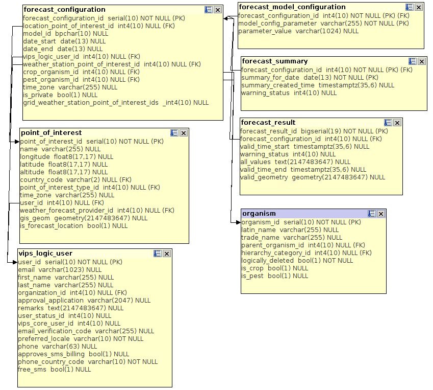
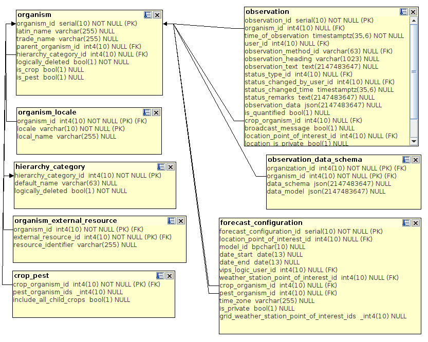

# Data model

## Organizations
For many aspects of VIPSLogic, the organization is the top level object. One organization may be "VIPS Norge" (VIPS in Norway). Entities that belong to one organization only are:

* Organization groups (e.g. adviser organizations) 
* Users, including their forecast configuratins, field observations, weather stations and farms
* Crop categories
* News messages
* Preparations (pesticides)
* History of batch jobs (task_history)
* Quantification schemas of field observations

## Forecast configurations and forecast results
This is a key part of VIPSLogic. The forecast configuration decribes how and where a DSS model is being run:
* It is owned by a user
* It is connected to a location
* It is connected to a weather station
* It specifies which model should be run
* It specifies which crop the model is run in
* It specifies which pest the model is run for
* It specifies when (e.g. from March 15th 2020 to August 31st 2020) a model should be run

The batch system starts regularly (could be every three hours, for instance) and queries the system for forecast configurations that should be run at the given date and time. All these forecast configurations are then queued. For each forecast configuration, the input data are being prepared (weather data, sowing dates etc.) and a request is sent to VIPSCore/VIPSCoremanager. The results from the model run are stored in the table forecast_result. They can be retrieved by any client through the appropriate [web service endpoint](https://logic.vips.nibio.no/public/RESTdocs/apidocs/resource_LogicService.html).

## Organisms (crops, pests, diseases and weeds)
Crops, pests, diseases and weeds are all organisms subject to [classification](https://en.wikipedia.org/wiki/Taxonomy_(biology)#Modern_system_of_classification). In VIPS, they are all placed in the organisms table. Following the rules of the classification system, the table is a tree structure. So each node (bar the root/top nodes) have a parent organism - which may be a family, genus etc.

### Crop categories
Each organization (NIBIO, Jordbruksverket, ADAS etc.) has their own set of crop categories. They can be e.g. cereals, fruit, vegetables. Each of these links to one or more organisms.