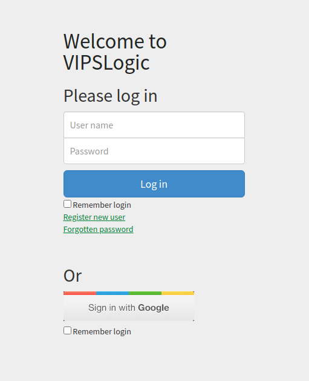
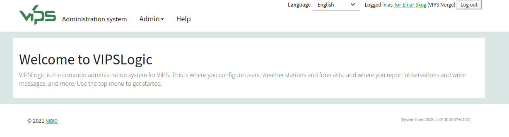

# VIPSLogic development and deployment guide

[The data model](./data_model.md)

[Authentication](./authentication.md)

[Messaging](./messaging.md)

[Troubleshooting](./troubleshooting.md)


## TODO: NEEDS UPDATE AFTER PATCHING JAN 2022
## Building VIPSLogic

### Recommended: Building with Docker
#### First: the database
The docker container needs a database. Important parts of the data model [is described in the Data Model chapter](./data_model.md).

So make sure you have PostgreSQL >= 10 and PostGIS >=2.4 installed. Then create a user called vipslogic. Make sure you enter the vipslogic username and password in the `standalone.xml` file of Wildfly (see chapter below).

 Next up is initalizing the database. Here's how to do it, as the PostgreSQL superuser (In Ubuntu, typically `postgres`)

``` sql
-- This script must be run as superuser (postgres)
-- Before you deploy VIPSLogic

SET statement_timeout = 0;
SET lock_timeout = 0;
SET client_encoding = 'UTF8';
SET standard_conforming_strings = on;
SET check_function_bodies = false;
SET client_min_messages = warning;
SET row_security = off;

CREATE USER vipslogic WITH PASSWORD :vipslogic_password;

CREATE DATABASE vipslogic
  WITH OWNER = vipslogic
       ENCODING = 'UTF8'
       TABLESPACE = pg_default
       LC_COLLATE = 'en_US.UTF-8'
       LC_CTYPE = 'en_US.UTF-8'
       CONNECTION LIMIT = -1;


-- WE NEED TO DO THIS IN ORDER TO MAKE flywaydb RUN THE INITIAL MIGRATION
-- MAKE SURE YOU REVOKE THIS PRIVILEGE AFTER FIRST DEPLOYMENT OF VIPSLOGIC
-- (Like this: ALTER ROLE vipslogic NOSUPERUSER;)

ALTER ROLE vipslogic SUPERUSER;

```


#### Building the VIPSLogic image
You need the
Make sure you're located in the parent folder of the VIPSLogic project. You need these resource files/folders in your current folder:
* standalone.xml (see below)
* VIPSCommon/ (can be cloned [from here](https://gitlab.nibio.no/VIPS/VIPSCommon)) - built with `mvn install`

Run

`sudo docker build --tag vips/logic:TEST01 -f VIPSLogic/Dockerfile .`

##### Contents of standalone.xml
VIPSLogic is using system properties for instance specific settings. In Wildfly (JBoss), these can be provided
in the standalone.xml file. Examples for this is available in the `wildfly_config_examples/` folder. 

#### Running VIPSLogic

`sudo docker run --publish 18080:8080 --add-host=vipslogicdb:[YOUR_HOSTS_IP_ADDRESS] --detach --name vipslogic vips/logic:TEST01`

`172.17.0.1` is the default IP adress for the Docker host if you are running on Linux. Change accordingly. On Mac and Windows you should be able to swap this for `host.docker.internal`.

#### Troubleshooting by logging in
`sudo docker exec -it <containername> bash`


#### Post build database operations
You need to complete these steps in order to have an organization and a super user in the system. Replace `$variable_name` with your info.

``` sql
INSERT INTO public.organization(organization_name,address1,address2,postal_code,country_code,default_locale,default_map_center,default_map_zoom,default_time_zone,city)
VALUES('$organization_name','$address_1','$address_2','$postal_code','$country_code','$default_language',ST_GeomFromText('POINT($longitude $latitude)',4326),4,'$timezone','$city');

-- You need the auto generated organization_id from the first INSERT
INSERT INTO public.vips_logic_user(email,first_name,last_name,organization_id,user_status_id,preferred_locale) 
VALUES('$user_email','$first_name','$last_name',(SELECT organization_id FROM public.organization WHERE organization_name='$organization_name'),4,'$default_language');

-- You need the auto generated user_id from the previous INSERT
-- To create the $passwordhash, see the python script below
INSERT INTO public.user_authentication(user_id,user_authentication_type_id,username,password) VALUES($userid,1,'$username','$passwordhash');

INSERT INTO public.user_vips_logic_role(vips_logic_role_id,user_id) VALUES(1,$userid);
```
To create the $passwordhash for the INSERT above, you can use this python script

``` python

# Python 3 code to demonstrate the  
# working of MD5 (string - hexadecimal) 
  
import hashlib 
  
# initializing string 
# salt must match the no.nibio.vips.logic.MD5_SALT in 
# WildFly's standalone.xml file
salt = "FoobarBarfoLoremipsum123"
p =  "YourUserPassword"
str2hash = p + salt
  
# encoding GeeksforGeeks using encode() 
# then sending to md5() 
result = hashlib.md5(str2hash.encode()) 
  
# printing the equivalent hexadecimal value. 
print("The hexadecimal equivalent of hash is : ", end ="") 
print(result.hexdigest()) # This is the $passwordhash to be used in the SQL above

```

#### Deployment
Whether you deploy using Docker or Wildfly (or another JEE server), the context path of the app is always /VIPSLogic. However, the app is designed to be accessible at the root level. So you always need to proxy it behind e.g. Apache or Nginx. Here's an example vhost for Apache:

``` apache
<VirtualHost *:80>
        ServerName vipslogic-local.no

        AddDefaultCharset UTF-8

        ProxyPass               /       http://localhost:18080/VIPSLogic/
        ProxyPassReverse        /       http://localhost:18080/VIPSLogic/
        ProxyPassReverseCookiePath      /VIPSLogic /
</VirtualHost>

```

After successful deployment in Apache (or Nginx), you should see this screen: 



Log in with your newly generated superuser credentials, and you get to this screen:



