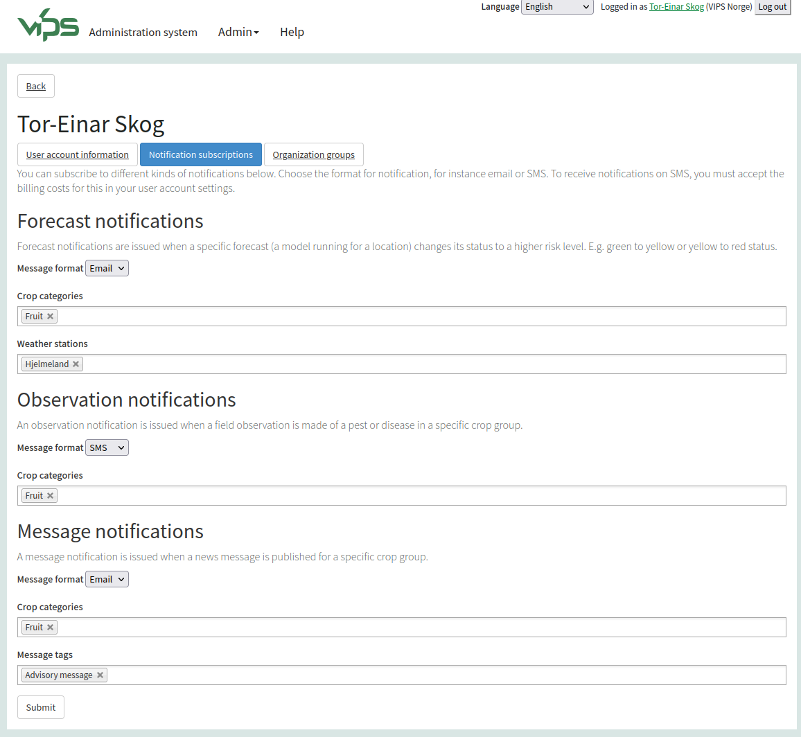
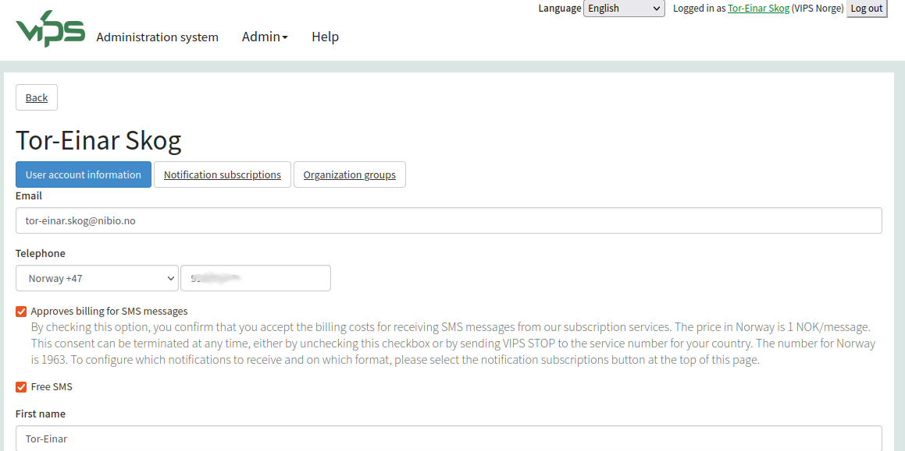

# VIPSLogic push notifications ("messaging")

**Last update: 2022-08-11**

VIPSLogic allows for push notifications for a few events:
* Publication of a news message tagged with a crop category and a message type selected by the user
* Publication of a field observation tagged with a crop category selected by the user
* A pest prediction forecast for a given crop category at a specified location changes from low to high risk (may happen during the daily update of the forecast)

**The notification system is generic; it can be adapted to send other types of notifications.**

The notifications may be sent as emails or tests (SMS), depending on the VIPSLogic server's available message gateways. See how to configure this below.

The user can change their notification preferences on their personal settings page (see illustration below)



On the personal settings main page, the user has to accept SMS billing - or be granted free SMSs by the super user (option only visible to super users).



## Code
The code for the messaging system is found in the `no.nibio.vips.logic.messaging` package and subpackages.

### Usage example


## Configuration
These system properties must be set in order for the messaging system to function:

```bash
# Set to true if you want to dry run the email system
no.nibio.vips.logic.messaging.dist.SIMULATE_MAIL_SENDING=true
# This will be the email sender address displayed to the receiver
no.nibio.vips.logic.messaging.dist.MAIL_SENDER_ADDRESS=noreply@foobar.com
# The URL to the SMS provider's API
no.nibio.vips.logic.messaging.dist.SMS_SERVER=smsgateway.foobar.com
# Username for the SMS gateway API
no.nibio.vips.logic.messaging.dist.SMS_USERNAME=foobar
# Password for the SMS gateway API
no.nibio.vips.logic.messaging.dist.SMS_PASSWORD=foobar
# Where the messaging system stores its logs
no.nibio.vips.logic.messaging.dist.TRAFFIC_LOG_DIRECTORY=/var/log/trafficLog/
```

How to configure these system properties may vary between application servers. The example below is from WildFly's `[...]/standalone/configuration/standalone.xml` configuration file. 

```xml
<system-properties>
    <property name="no.nibio.vips.logic.messaging.dist.SIMULATE_MAIL_SENDING" value="true"/>
    <property name="no.nibio.vips.logic.messaging.dist.MAIL_SENDER_ADDRESS" value="noreply@foobar.com"/>
    <property name="no.nibio.vips.logic.messaging.dist.SMS_SERVER" value="smsgateway.foobar.com"/>
    <property name="no.nibio.vips.logic.messaging.dist.SMS_USERNAME" value="foobar"/>
    <property name="no.nibio.vips.logic.messaging.dist.SMS_PASSWORD" value="foobar"/>
    <property name="no.nibio.vips.logic.messaging.dist.SMS_SENDER_SRC" value="foobar"/>
    <property name="no.nibio.vips.logic.messaging.dist.TRAFFIC_LOG_DIRECTORY" value="/var/log/trafficLog/"/>
</system-properties>
```