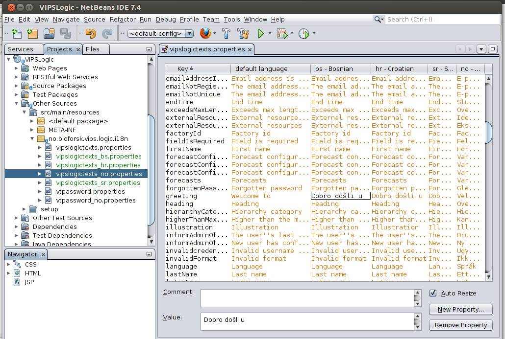

# Translating VIPSLogic
2022-09-22

## How the translation works
VIPSLogic is written in Java. Java's standard way of handling translation is by using ResourceBundle. ResourceBundle is a Java class that is used to store texts and components that are locale sensitive. To print a localized text, we could do it this way (FreeMarker example from VIPSLogic code):

```html
<h1>${i18nBundle.greeting} VIPSLogic</h1>
```

The ${} markup is FreeMarker specific. «i18nBundle» is our instance of the ResourceBundle class. The important stuff here is the keyword «greeting». This is used by the ResouceBundle class to look up the localized phrase. Where does it look for the phrase? It looks in a properties file called `vipslogictexts_[language_code].properties`. So, if your browser has set Norwegian as its preferred language, «no» is the code for Norwegian, and the ResourceBundle class looks for `vipslogictexts_no.properties`, it looks in that file for the keyword «greeting». In that file, the line with «greeting» looks like this:

```properties
greeting=Velkommen til
```

Thus, what is printed in the end, is

```html
<h1>Velkommen til VIPSLogic</h1>
```

IF, however, the file vipslogictexts_no.properties does not exist (the translation has not been made yet), the ResourceBundle loads the file `vipslogictexts.properties` .
This file contains all the phrases in VIPSLogic's default language, which is English. In that file, the line with the «greeting» keyword looks like this:

```
greeting=Welcome to
```

So in that case, what's printed is of course

```html
<h1>Welcome to VIPSLogic</h1>
```

## How to edit a language file
The easiest way to edit a language file, is to use a ResourceBundle editor. NetBeans has a good one. See screenshot below



There are also ResourceBundle editors available for Eclipse, for instance this one: https://marketplace.eclipse.org/content/dazzle

It's of course also possible to edit the files one by one in an ordinary text editor like NotePad, jEdit, Emacs, etc. In that case, please make sure to set the character set for the file to be UTF-8.

The VIPSLogic properties files are located in `[VIPSLogic_HOME]/src/main/resources/no/nibio/vips/logic/i18n/`